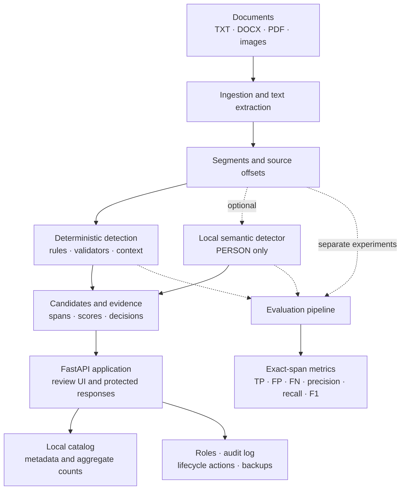

<div align="center">

# Russian PII Detection & Data Ecology

**Find personal data in documents. Review the evidence. Understand the document lifecycle.**

A local-first Python coursework project combining explainable PII detection, document ingestion, a reviewable catalog, and reproducible evaluation.

[](https://github.com/feuerstrahll/ru-pii-detection-system/actions/workflows/tests.yml)

[](LICENSE)

[**Quick start**](#quick-start) · [**Architecture**](#how-it-works) · [**Evaluation**](#evaluation-and-reproducibility) · [**Documentation**](#documentation)

</div>

> [!NOTE]
> **Designed for local, controlled use and coursework evaluation.** The default detector runs without a cloud LLM. Development and benchmark scores are **not** estimates of accuracy on real organizational documents.

## At a glance

| | Capability | What to expect |
| :---: | --- | --- |
| 🔎 | **Explainable PII detection** | Rules, format validators, contextual signals, scores, and source-text offsets |
| 🧠 | **Optional semantic PERSON detection** | Frozen, locally executed model with a verified snapshot; no semantic ADDRESS detection |
| 📄 | **Document ingestion** | UTF-8 TXT, DOCX, PDF, and images; OCR available with additional dependencies |
| 🗂️ | **Local document catalog** | FastAPI application with review UI, roles, audit log, lifecycle operations, and backups |
| 🧪 | **Separate evaluation pipeline** | Exact-span metrics, frozen experiment results, provenance notes, and reproducible commands |

## How it works



**The design separates candidate generation from validation.** A regex match is not automatically a validated identifier. Predictions can retain document and segment IDs, source spans, detector evidence, scores, and decisions. The application stores catalog metadata and aggregate PII counts; protected analysis responses may include source text and detected values.

## Quick start

**Requirements:** Python **3.11+** and [`uv`](https://docs.astral.sh/uv/). The commands below use **PowerShell** and should be run from the repository root.

### 1. Install dependencies

```powershell
uv sync --extra test --extra test-data
```

### 2. Choose a local document directory

```powershell
$env:PII_SOURCE_ROOT = 'C:\path\to\test-documents'
```

Use synthetic documents for a public demo. Do not point the application at confidential organizational files unless the environment and access controls are appropriate.

### 3. Initialize and run

```powershell
uv run python -m app.api.main init-db
uv run python -m app.api.main serve
```

`init-db` prompts for an administrator login and a password of **at least 12 characters**.

**Open the local application:** **http://127.0.0.1:8765**

The SQLite catalog and analysis cache are created under `var/`, which is excluded from Git.

> [!IMPORTANT]
> The application is intended to run on **`127.0.0.1`**. Exposing it outside the host requires additional transport security and access controls. Do not treat the local setup as a production deployment.

## Detection modes and boundaries

| Mode | Available behavior | Important limitation |
| --- | --- | --- |
| **Deterministic — default** | Configured patterns, validation rules, context signals, and scoring | Does **not** detect `PERSON` or `ADDRESS`; rule scores are **not calibrated probabilities** |
| **Semantic — optional** | Adds `PERSON` recognition with a frozen local model | Requires a separate, hash-checked model snapshot; `ADDRESS` is disabled |
| **OCR — optional** | Extracts text from scanned PDF pages and images | Requires Tesseract, relevant language data, and optional OCR dependencies |

The semantic model weights are **not** bundled with the repository. If the frozen PERSON snapshot is missing, the application reports a model error; deterministic detection remains available.

For exact setup instructions, see the [system guide](docs/SYSTEM_START.md).

## Evaluation and reproducibility

Evaluation lives outside the application code. It reports **exact-span** results per entity type: true positives, false positives, false negatives, precision, recall, and F1.

### Run tests

```powershell
uv run --extra test --extra test-data python -m pytest -q
```

### Re-run the deterministic development evaluation

```powershell
New-Item -ItemType Directory -Force var | Out-Null
uv run python -m evaluation.run --dataset data/dev_set --config configs/deterministic_v3.json --errors-out var/dev_errors.json
```

`data/dev_set` is a **frozen synthetic development corpus**, not an independent held-out estimate of real-world deployment performance. The error report is saved locally because it includes source spans.

| Evidence | Where to find it | Interpretation |
| --- | --- | --- |
| Deterministic baseline | [`artifacts/tier0_deterministic_v3.json`](artifacts/tier0_deterministic_v3.json) | Recorded earlier run on the development corpus |
| Semantic experiment details | [`docs/SEMANTIC_EXPERIMENTS.md`](docs/SEMANTIC_EXPERIMENTS.md) | Model comparisons, evaluation setup, and limitations |
| NEREL PERSON benchmark | [`artifacts/nerel_person_01/`](artifacts/nerel_person_01/) | Frozen external results with provenance and hashes |
| redmadrobot benchmark | [`artifacts/redmadrobot_frozen_01/`](artifacts/redmadrobot_frozen_01/) | Frozen external results with provenance and hashes |

> [!CAUTION]
> Development and external benchmark results concern **different data populations** and should not be averaged or presented as production accuracy. The original external corpora and model weights are not bundled, so the frozen external runs cannot be fully reproduced from this checkout alone.

## Repository structure

```text
ru-pii-detection-system/
├── app/          # Ingestion, detection, API, schemas, storage
├── configs/      # Versioned detector and experiment settings
├── data/         # Synthetic development data and small benchmark inputs
├── evaluation/   # Dataset adapters, metrics, benchmark entry points
├── artifacts/    # Recorded experiment results and provenance
├── tests/        # Unit and integration tests
├── docs/         # Setup guides, stage reports, experiment notes
└── scripts/      # Model download and utility commands
```

## Documentation

| Guide | Covers |
| --- | --- |
| 📘 [System start guide](docs/SYSTEM_START.md) | Local setup, interface, roles, optional model and OCR configuration |
| 🧪 [Semantic experiments](docs/SEMANTIC_EXPERIMENTS.md) | Experimental methods, recorded results, interpretation limits |
| 💾 [Lifecycle and backup walkthrough](docs/LIFECYCLE_BACKUP_DEMO.txt) | Backup and document lifecycle demonstration |

The system and lifecycle guides are written in **Russian**.

<details>
<summary><strong>Data handling, security, and publication boundaries</strong></summary>

- The repository excludes local credentials, runtime databases, model weights, the coursework manuscript, and reference PDFs.
- Do **not** commit organizational documents, raw personal data, or local evaluation error reports containing source spans.
- The application stores catalog metadata and aggregate PII counts. Protected analysis responses can still contain source text or detected values.
- Some benchmark artifacts contain research-dataset examples or predictions. Check source attribution and redistribution terms before republishing them.
- A local-only application is **not** a substitute for deployment security, permission reviews, or an organizational data-protection policy.

</details>

## License

The source code is distributed under the [MIT License](LICENSE). **Datasets and model weights have their own licenses** and may be subject to different usage or redistribution conditions.
