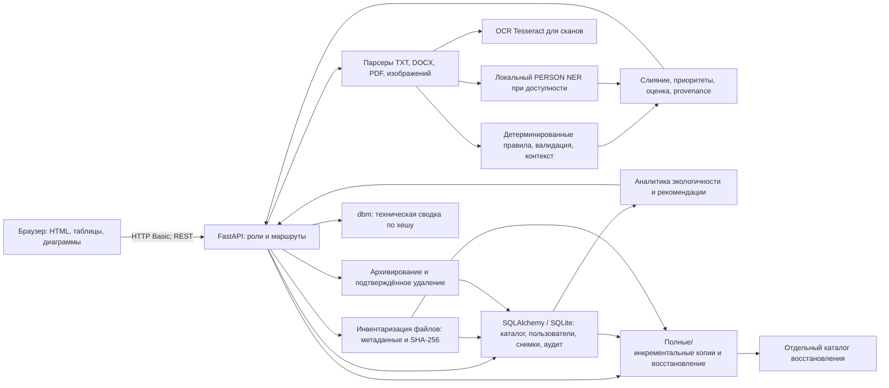
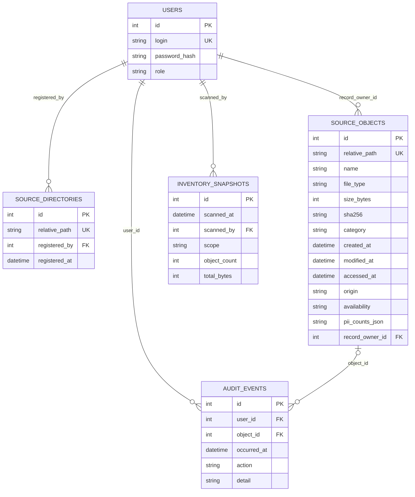

# Этап 11. Проверяемые материалы для ПЗ и защиты

Срез: 04.11.2026. Это техническая основа для **двух глав**, а не готовый текст ПЗ. Исходная `Курсовая.docx` не изменялась. По разделу «Пояснительная записка» методички теоретическая часть образует главу 1, а описание программы, классов и результатов применения — главу 2. В таблицах ниже «реализовано» означает подтверждение кодом и тестом; план и оценки на синтетических данных отделены от измерения организации.

## Глава 1. Теоретические основы и предметная область

### Смысл и границы исследования

В. Г. Абашин рассматривает экологию данных через потенциальные отрицательные последствия информационной системы для среды, человека и социальных отношений; понятие не сводится к размеру хранилища. В §2.1 монографии токсичность системы рассматривается по составляющим данных, алгоритмов, вычислений и человеческого фактора. Для этой работы операционализирована **только составляющая хранения данных**: избыточность, неактуальность, неполнота метаданных и признаки возможного риска хранения ПДн. Обнаружение ПДн само по себе не устанавливает нарушение закона и не делает каждый документ «токсичным». Источник: [Абашин, «Экология данных», 2025, §2.1](https://izd-mn.com/PDF/46MNNPM25.pdf); локальный файл `Абашин_Экология данных.pdf`.

Неструктурированные TXT, DOCX, PDF и изображения различаются способом извлечения текста. PDF может иметь текстовый слой либо требовать OCR; скан даёт ошибки распознавания и координаты слов; в DOCX важны границы абзацев и таблиц. Для интерпретации находки сохраняются исходный сегмент, смещения, страница/координаты, сигнал детектора и статус решения. Неизвестная дата доступа не доказывает отсутствие обращений; одинаковый SHA-256 подтверждает совпадение байтов на момент инвентаризации, но не право удалить файл. [SHA-256 определён стандартом NIST FIPS 180-4](https://csrc.nist.gov/pubs/fips/180-4/upd1/final).

### Методы и обоснование выбора

| Подход | Применение в работе | Ограничение |
|---|---|---|
| Правила, форматы, контрольные суммы, контекст | Структурированные идентификаторы, почта, телефон; проверяемые сигналы и объяснимое решение | Имена и адреса зависят от контекста; валидный формат не гарантирует правильную классификацию |
| OCR | Изображения и страницы PDF без текстового слоя; сохраняются confidence и координаты | Ошибки OCR влияют на последующую детекцию; качество на контрольном скане не переносится на весь архив |
| Локальная семантическая PERSON-модель | Контекстные имена; гибридный `HybridPipeline` добавляет PERSON к правилам | Живой HTTP-тест прошёл вне управляемой песочницы; внутри неё загрузка NumPy DLL запрещена. ADDRESS в frozen policy отключён |
| SHA-256 и метаданные жизненного цикла | Полные дубликаты, примерные версии, давность доступа и срок хранения | Версии и «тёмные» данные — кандидаты для проверки, а не доказанные лишние файлы |

Коммерческие и открытые аналоги сравниваются **по опубликованным возможностям**, без утверждений об их точности на русском корпусе данной организации:

| Решение | Опубликованные возможности | Вывод для проекта |
|---|---|---|
| [Microsoft Purview](https://learn.microsoft.com/en-us/purview/data-classification-overview), [Lifecycle Management](https://learn.microsoft.com/microsoft-365/compliance/data-lifecycle-management) | Типы чувствительной информации, классификаторы, OCR и retention в экосистеме Microsoft 365 | Показывает связь обнаружения и жизненного цикла; локальный прототип нужен для контролируемых файловых источников и явного российского профиля сущностей |
| [Google Sensitive Data Protection](https://docs.cloud.google.com/sensitive-data-protection/docs/sensitive-data-protection-overview) | Инспекция структурированных и неструктурированных данных, конфигурируемые infoTypes | Полезен как пример политики классификации; отправка производственных документов во внешний облачный сервис здесь не предусмотрена |
| [Presidio](https://microsoft.github.io/presidio/analyzer/) | Расширяемые распознаватели и подключаемые NER-движки | Подтверждает применимость комбинированного подхода; собственная таксономия и проверка смещений нужны для экспериментального контракта проекта |

### Вопросы для согласования

Методичка, пункт 1.9, требует метрики объёма, избыточности, актуальности, качества и обоснованный индекс. В текущем прототипе не измерены подтверждённые доли резервных/производных копий, сжимаемость, качество верификации всех предметных полей и защищённость хранения; поле категории копии есть, но его классификация не доказана. Следует согласовать с руководителем замену этих величин на «не измерено», использование внутреннего срока хранения как сигнала для проверки, состав и веса индекса, категории и сроки, а также допустимый размеченный корпус для оценки переноса PII-детектора. Основание: `КР_ЭД_Методичка_Версия_002.docx`, раздел «Оценка экологичности (токсичности) данных»; методика текущего расчёта — `docs/ECOLOGY_STAGES_5_6.txt`.

## Глава 2. Проектирование, реализация и оценка

### Архитектурная схема

Один локальный процесс обслуживает интерфейс и REST. `evaluation/` выполняется отдельно от production-кода. В анализе загруженного документа ответ содержит текст и найденные значения на время запроса; в SQLite сохраняются метаданные и агрегированные счётчики, в `dbm` — техническая сводка по хешу. Резервные копии содержат исходные управляемые файлы и поэтому требуют отдельной защиты. HTTP Basic в текущем запуске допустим только на `127.0.0.1`; внешний доступ потребует TLS и пересмотра сессий. База и резервные копии не шифруются самим приложением.

### ER-диаграмма фактической SQLite-схемы

`SourceDirectory` и `SourceObject` связаны областью сканирования в приложении, но **не внешним ключом**. Диаграмма сокращает перечень полей `SourceObject`; полный контракт — `app/storage/catalog.py`. Кэш `dbm`, управляемые файлы, архив и манифесты копий не являются таблицами SQLite.

### Классы и модули

| Модуль | Основные классы / функции | Назначение |
|---|---|---|
| `app/api/main.py`, `app/api/ui.py` | `create_app`, Pydantic-схемы запросов, `dashboard` | Авторизация, роли, REST, HTML и обработка ошибок |
| `app/storage/catalog.py` | `User`, `SourceDirectory`, `SourceObject`, `InventorySnapshot`, `AuditEvent` | ORM-модель, парольные хеши, миграция SQLite |
| `app/storage/ecology.py` | `report` | Снимки объёма, дубликаты, сроки, индекс, рекомендации, оценки эффекта |
| `app/storage/lifecycle.py`, `backup.py` | `archive`, `delete_archived`, `create_backup`, `restore_backup` | Контроль хеша, операции над файлами, журналируемое восстановление |
| `app/ingestion/*.py`, `app/core/parsers.py` | `TextDocumentParser`, `DocxDocumentParser`, `OCRDocumentParser`, `ParserRegistry` | Извлечение текста, страниц, OCR и ошибок |
| `app/core/pipeline.py`, `app/detection/*.py` | `DeterministicPipeline`, `HybridPipeline`, `RegexCandidateGenerator`, `StructuredValidator`, `EngineeredEvidenceScorer`, `GLiNER2SemanticAdapter` | Кандидаты, проверка, контекст, PERSON, объединение и provenance |
| `app/schemas/models.py`, `app/core/config.py` | `DocumentSegment`, `EntityCandidate`, `DetectedEntity`, `DetectorConfig`, `OCRConfig` | Типизированные контракты и конфигурация |
| `evaluation/` | `evaluate`, benchmark-модули | Отдельный расчёт TP/FP/FN, Precision/Recall/F1 и ошибок |

### Реализованные функции и границы

| Функция | Состояние и подтверждение | Граница |
|---|---|---|
| Вход, роли, каталог, поиск, снимки инвентаризации | Реализовано; `tests/integration/test_system.py` | HTTP Basic — локальный режим |
| TXT, DOCX, PDF, OCR, структурированные ПДн | Реализовано; HTTP-тесты и `tests/unit/test_ocr_adapter.py` | OCR проверен на синтетическом скане, не на корпусе организации |
| PERSON в гибридном составе | Живой HTTP-тест с локальной GLiNER2 прошёл на синтетическом TXT; тест композиции и сохранённые benchmark-результаты есть | В управляемой песочнице нативная NumPy DLL не загружается; ADDRESS отключён; качество на документах организации не измерено |
| Дубликаты, примерные версии, «тёмные» объекты, индекс | Реализовано; `tests/unit/test_ecology.py` | Оценка по метаданным и только присутствующим файлам каталога |
| Retention, архив, подтверждённое удаление | Правила в JSON, ручные операции администратора; тест жизненного цикла | Автоматический перевод по расписанию не реализован; физическое стирание не гарантировано |
| Полная/инкрементальная копии, восстановление | Реализовано; интеграционный тест с порчей blob | Нет встроенного шифрования и защищённого внешнего хранилища |
| Дашборд, рекомендации, журнал | Реализовано; `app/api/ui.py` и тесты | Динамика индекса и других рисков по времени не хранится; показаны снимки объёма и числа объектов |
| Стоимость и энергия | Расчёт реализован; коэффициенты в `configs/ecology_v1.json` | По умолчанию коэффициенты `null`, поэтому чисел организации нет; ввод через JSON, не форму UI |

### Формулы и воспроизводимая методика

Обозначения: `P` — множество присутствующих файлов каталога, `sᵢ` — известный размер файла, `D` — копии сверх одного выбранного экземпляра в каждой группе одинаковых SHA-256, `A` — объекты с известным последним доступом, `X` — объекты с применимым сроком и известной исходной датой. Каждая доля при нулевом знаменателе получает `null`.

| Показатель | Формула / правило | Направление |
|---|---|---|
| Известный объём | `V = Σᵢ∈P, sᵢ известен sᵢ`; неизвестные размеры считаются отдельно | Описание масштаба, сам по себе не риск |
| Доля полных копий | `|D| / |P|`; лишние байты `Vᴅ = Σᵢ∈D sᵢ` | Больше — больше избыточность |
| Верхняя оценка кандидатов | `Σᵢ∈(D∪T∪X) sᵢ` по **уникальным ID**, где `T` — «тёмные»; при неизвестном размере — `null` | Это возможность, не фактически освобождённый объём |
| «Тёмные» | `now − accessed_at > dark_days`; доля `|T|/|A|` | Больше — больше риск неактуальности |
| Превышение срока | Для заданной категории `now − (created_at или modified_at) > retention_days`; доля `|X|/|применимые|` | Больше — больше отклонений от внутреннего правила |
| ПДн-профиль | `число документов с находками / число завершённых анализов`; счётчики сущностей по классам | Сигнал для проверки, не юридический вывод |
| Качество метаданных | `число файлов с пустым владельцем, категорией или размером / |P|` | Больше — хуже полнота |

Нормированные компоненты риска индекса: `r₁=Vᴅ/V`, `r₂=|T|/|A|`, `r₃=доля неполных метаданных`, `r₄=|X|/|применимые|`. Все лежат в `[0,1]`; большее значение означает больше измеренного риска. **Индекс** `E = 100 × (1 − Σᵢ∈K wᵢrᵢ / Σᵢ∈K wᵢ)`, где `K` — доступные компоненты. Текущие `wᵢ=0,25` равны, поскольку организация не предоставила обоснованной шкалы относительного вреда; это проектные веса, не научные коэффициенты. При `K=∅` индекс `null`; `partial` и сумма доступных весов показывают неполный охват. Сравнение разных охватов и политик без оговорки некорректно. F1 детектора в `E` не входит.

Для `c` рублей/ГиБ·мес, `e` кВт·ч/ГиБ·мес, долей архива `αc`, `αe`, активного объёма `V`, архивного `Vₐ`: `C=(V+αcVₐ)c/2³⁰`, `Q=(V+αeVₐ)e/2³⁰`. При предложенном удалении уникальных файлов на `Vᵤ` байт и перемещении в архив на `Vₘ` байт: `ΔC=[Vᵤ+(1−αc)Vₘ]c/2³⁰`, `ΔQ=[Vᵤ+(1−αe)Vₘ]e/2³⁰`. Архивирование не уменьшает физический объём; копии и дедупликация могут уменьшить реальный эффект. Нынешние `c` и `e` равны `null`, а `αc=αe=1`; экономический результат организации не рассчитан.

Для оценки детектора: `Precision=TP/(TP+FP)`, `Recall=TP/(TP+FN)`, `F1=2PR/(P+R)`; при нулевом знаменателе применяется соглашение `evaluation/metrics.py`. Exact span требует совпадения документа, сегмента, границ и класса. Micro агрегирует TP/FP/FN по классам; macro усредняет F1 классов. Эти метрики характеризуют распознавание, а не экологичность.

### Контрольный расчёт экологичности

Из `tests/unit/test_ecology.py`, **только синтетический пример**: 3 файла по 10 байт, один лишний SHA-256 экземпляр (10 байт), два «тёмных» при одной неизвестной дате доступа, три превышения тестового внутреннего срока, верхняя оценка кандидатов 30 байт, индекс `41,67/100`. Это подтверждает арифметику и учёт каждого ID один раз. Это **не измерение документов организации** и не основа для вывода о её фактической экологичности. Для ПЗ нужен согласованный корпус или явно обоснованный моделированный набор с описанием объёма, состава, дат, категорий и коэффициентов.

### Таблицы профильных экспериментов

| Эксперимент / источник | Охват | Precision | Recall | F1 | Ограничение |
|---|---:|---:|---:|---:|---|
| `deterministic_v3`, `data/dev_set`, BANK_CARD | 95 TP, 7 FP, 0 FN | 0,931 | 1,000 | 0,964 | Синтетический development-набор, не финальная точность |
| `deterministic_v3`, `data/dev_set`, PASSPORT | 95 TP, 183 FP, 0 FN | 0,342 | 1,000 | 0,509 | Много ложноположительных, нет публичной контрольной суммы паспорта |
| PERSON frozen v2, PII-Bench `entity` | 910 документов, 70 gold PERSON | 0,623 | 0,943 | 0,750 | Отдельный сохранённый PERSON-прогон |
| PERSON frozen v2, PII-Bench `domain` | 900 документов, 158 gold PERSON | 0,940 | 0,987 | 0,963 | Другая тематическая область, не документы организации |
| Гибридный **сохранённый** replay, PII-Bench `entity` | 9 из 12 классов; TP 667, FP 45, FN 33 | 0,937 | 0,953 | 0,945 | Сохранённый `artifacts/pii_bench_hybrid_replay_v1.json`, без живого inference |
| Гибридный текущий пересчёт replay, PII-Bench `entity` | 910 документов | — | — | 0,968 micro | Этап 10; расходится с сохранённым артефактом, причина ещё не установлена |
| Гибридный текущий пересчёт replay, PII-Bench `domain` | 900 документов | — | — | 0,972 micro | Тот же открытый вопрос воспроизводимости |
| Frozen hybrid, Redmadrobot test | 7 сопоставимых классов; 2841 строка | 0,705 | 0,439 | 0,541 micro | Сопоставимо 2841 из 5614 исходных упоминаний; корпус и таксономия другие |
| Frozen PERSON, NEREL test | 93 документа, 961 PERSON | 0,945 | 0,770 | 0,849 exact | Только PERSON; 961 из 5827 аннотаций поддержаны |

Источники чисел: `artifacts/tier0_deterministic_v3.json`, `artifacts/pii_bench_semantic_person_v2.json`, `artifacts/pii_bench_hybrid_replay_v1.json`, `artifacts/redmadrobot_frozen_01/results.json`, `artifacts/nerel_person_01/results.json`, `docs/STAGE10_TEST_REPORT.md`. Для PII-Bench в гибридном сохранённом replay исключены ADDRESS, CVC, TOKEN. Текущий пересчёт этапа 10 **не следует подменять** сохранённым результатом и нельзя выдавать его за независимое подтверждение улучшения, пока расхождение не объяснено. Никакая из таблиц не доказывает качество на документах организации.

### Тестирование и интерфейс

Этап 10: `109 passed` в первоначальном модульном и интеграционном наборе; отдельно `1 passed` для живого HTTP-теста PERSON + EMAIL вне управляемой песочницы. HTTP-проверки охватили 401/403, инвентаризацию, CRUD и поиск, TXT/PDF, реальный OCR синтетического скана, чистый документ, некорректные файлы, кандидатов и индекс, архивирование с точным подтверждением, полную/инкрементальную копии и проверку повреждённого blob при восстановлении. Первоначальный сбой импорта NumPy DLL воспроизводился только внутри песочницы; это ограничение среды запуска, а не провал установленной модели. Подробные фактические статусы — `docs/STAGE10_TEST_REPORT.md`.

Основная страница имеет разделы: авторизация, дашборд, источники, каталог, обнаружение ПДн, дубликаты и неактуальные объекты, рекомендации и жизненный цикл, копии, журнал, пользователи/роли, об авторе. Диаграммы показывают объём по формату/категории и динамику зарегистрированного объёма/числа объектов; таблицы — риски, находки и операции. После загрузки отдельное окно показывает страницы PDF/изображений с координатными рамками, TXT с выделениями и структурный просмотр DOCX с выделениями. DOCX не воспроизводит точную пагинацию Word и встроенные изображения. Разделы зависят от роли. На странице «Об авторе» есть имя и группа из титульного листа, но сведения о контактах, опыте и датах из требования методички пока не подтверждены.

### Сценарий демонстрации для защиты

1. Подготовить **изолированную копию проекта с чистым `var`** и каталогом только синтетических TXT/PDF/PNG; заранее проверить Tesseract и наличие `rus`/`eng`. Записать версии конфигураций и дату. Не использовать файлы организации.
2. Задать `PII_SOURCE_ROOT` на тестовый каталог и `PII_DATABASE_URL` на тестовую SQLite, выполнить `uv run python -m app.api.main init-db`, затем `uv run python -m app.api.main serve`; открыть `http://127.0.0.1:8765` и войти администратором.
3. Зарегистрировать источник, просканировать, показать таблицу объектов и SHA-256. Создать две идентичные тестовые копии и файл с конечным маркером версии; повторить сканирование и показать группы дубликатов/вероятных версий.
4. Вне управляемой песочницы проверить `PII_LIVE_MODEL_TEST=1` и загрузить контрольный TXT с синтетическими PERSON и EMAIL, цифровой PDF и скан; показать режим `hybrid`, сущности, исходные смещения и OCR-координаты. При невозможности загрузить модель в среде защиты показать `deterministic_only` и указать причину.
5. Открыть дашборд: отделить измеренный объём от неизвестных размеров и оценочных показателей. Для демонстрации стоимости/энергии в **копии конфигурации** задать тестовые коэффициенты и объяснить единицы, веса и `partial`; вернуть исходную конфигурацию после показа.
6. Создать полную копию, затем показать рекомендацию как предложение и архивировать тестовый файл администратором. Добавить новый тестовый файл, пересканировать и создать инкрементальную копию. Восстановить её в отдельный каталог, сверить файлы и статус в SQLite. На отдельной копии backup-хранилища испортить blob и показать отказ по SHA-256.
7. Показать 409 при неверном подтверждении удаления, затем точное подтверждение и журнал. Войти аудитором, показать доступ к чтению и 403 на изменение. Завершить таблицей экспериментов и открытыми ограничениями.

Перед переносом этого материала в ПЗ: разрешить расхождение replay, согласовать с руководителем отклонения от пункта 1.9, получить основание для срока хранения и удельных коэффициентов, провести количественный прогон на согласованном корпусе. Исходную ПЗ обновлять только после этой проверки.
